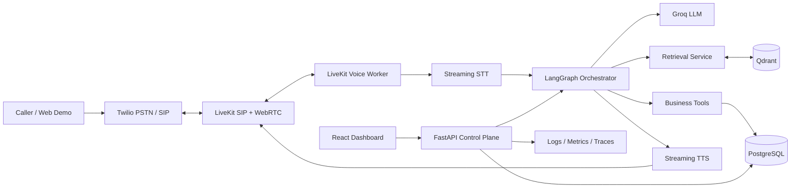

# VoxAssist AI — Real-Time AI Voice Agent for Customer Service

VoxAssist is a modular, phone-capable customer support voice agent. It receives audio, transcribes speech, classifies intent, retrieves grounded answers from a company knowledge base, calls approved business tools (order lookup / appointment booking), speaks the response, and can hand a call to a human.

> **Status:** portfolio-ready starter implementation. The local text/demo API and RAG pipeline can run without paid telephony or speech accounts. LiveKit, Twilio, Deepgram, Cartesia/ElevenLabs and Groq are optional integrations and require provider credentials. Do not represent a local demo as a live PSTN deployment.

## Product goals

- Natural, low-latency voice conversations with interruption handling.
- Grounded FAQ answers using retrieval-augmented generation (RAG), with abstention when evidence is weak.
- Structured tools for order status and appointment scheduling.
- Safe human escalation for low confidence, complaints, sensitive requests, or explicit caller requests.
- Agent dashboard for calls, transcripts, outcomes, knowledge ingestion and quality analytics.
- Secure-by-default handling of secrets, PII, call recordings and provider webhooks.

## Feature set

### Core
- FastAPI backend with health, chat simulation, knowledge ingestion/search, calls, metrics and tool endpoints.
- LangGraph workflow: normalize → classify → retrieve → decide → answer/tool/escalate → persist result.
- Qdrant vector search with local Sentence Transformers embeddings; in-memory fallback for tests/demo.
- Groq OpenAI-compatible chat completion adapter; deterministic fallback for offline development.
- Mock order and appointment services with idempotency keys and validation.
- LiveKit Agents worker entry point for real-time sessions (provider plugin setup documented separately).
- Twilio SIP / LiveKit integration guide for inbound and outbound PSTN calls.
- React + TypeScript dashboard starter with overview, call activity, knowledge base and settings views.

### Added portfolio features
- Confidence thresholds and explicit “I don't know” behavior.
- Human handoff reason and summary payload.
- Prompt-injection-resistant RAG instructions: retrieved documents are data, never instructions.
- Consent/recording configuration and retention policy hooks.
- CORS allowlist, structured logs, upload limits and environment-based secret configuration. (Add distributed rate limiting and request tracing before public launch.)
- Docker Compose for API, Qdrant, PostgreSQL and Redis.
- Unit tests, security checklist, CI workflow, threat model and deployment runbook.

## Architecture



### Component responsibilities
| Component | Responsibility |
|---|---|
| Twilio | Phone numbers, PSTN connectivity, SIP trunking and call routing |
| LiveKit | Real-time audio rooms, SIP participant connectivity, agent session lifecycle |
| LiveKit worker | Voice pipeline, turn detection, interruptions and audio publishing |
| FastAPI | Dashboard/control plane, ingestion, business APIs, health and admin endpoints |
| LangGraph | Stateful reasoning workflow and conditional routing |
| Groq | Hosted open-weight LLM inference (model availability and limits vary) |
| Qdrant | Vector similarity retrieval over approved company content |
| PostgreSQL | Calls, transcript metadata, appointments, demo orders and audit events |
| Redis | Rate limiting / ephemeral cache / future job coordination |

### Call workflow
1. Caller dials the Twilio number. Twilio routes the call through a configured SIP trunk to LiveKit.
2. LiveKit dispatches a worker into the call room. The worker greets the caller and obtains consent where recording/transcription is enabled.
3. Streaming STT converts caller audio into text. Voice activity detection and turn detection determine when the caller has finished speaking.
4. The worker passes the utterance and call context to the FastAPI/LangGraph agent service.
5. LangGraph classifies intent and risk. For FAQs it retrieves relevant chunks from Qdrant; for orders or bookings it validates required fields and invokes a business tool.
6. The LLM generates a concise response grounded in retrieved evidence and tool results. Low retrieval confidence, repeated failures, anger/complaint or “human” requests route to handoff.
7. TTS streams speech back through LiveKit to the caller. Caller interruptions cancel/replace the current response.
8. Call outcome, duration, transcript (if enabled), tool activity and escalation summary are persisted for the dashboard.

### RAG ingestion workflow
1. Admin uploads `.txt`, `.md` or `.pdf` knowledge documents through the dashboard/API.
2. Extract text, normalize whitespace, split into overlapping chunks, attach source/title/tenant metadata.
3. Generate embeddings using `sentence-transformers/all-MiniLM-L6-v2` by default.
4. Upsert vectors into Qdrant collection `voxassist_kb`.
5. At query time, retrieve top-k chunks, apply a score threshold, and pass only relevant excerpts with source IDs to the model.
6. The model must cite source titles in its answer. If evidence is missing or contradictory, ask a clarifying question or escalate.

## Repository layout

```text
voxassist-ai/
├── backend/
│   ├── app/
│   │   ├── api/              # FastAPI routes
│   │   ├── agents/           # LangGraph workflow + LiveKit worker
│   │   ├── core/             # settings, logging, security helpers
│   │   ├── services/         # LLM, RAG, tools, persistence
│   │   └── main.py
│   ├── tests/
│   └── requirements.txt
├── frontend/                 # React + TypeScript dashboard
├── docs/                     # system design, threat model, runbooks
├── scripts/                  # sample KB ingestion
├── docker-compose.yml
├── .env.example
└── README.md
```

## Quick start (local demo)

### Prerequisites
- Python 3.11 or 3.12
- Node.js 20+
- Docker Desktop (recommended for Qdrant/Postgres/Redis)
- Git

### 1. Configure environment

```bash
cp .env.example .env
```

Set `GROQ_API_KEY` for hosted reasoning. Without it, the API uses a deterministic demo response so the project remains runnable offline. Never commit `.env`.

### 2. Start infrastructure

```bash
docker compose up -d qdrant postgres redis
```

Qdrant dashboard/API: `http://localhost:6333/dashboard`

### 3. Start backend

```bash
cd backend
python -m venv .venv
# Windows PowerShell: .venv\Scripts\Activate.ps1
# macOS/Linux: source .venv/bin/activate
pip install -r requirements.txt
uvicorn app.main:app --reload --host 0.0.0.0 --port 8000
```

Open `http://localhost:8000/docs` and `http://localhost:8000/health`.

### 4. Load sample knowledge

```bash
python ../scripts/seed_knowledge.py
```

Or upload a document via `POST /api/v1/knowledge/upload` (multipart form, field `file`).

### 5. Start frontend

```bash
cd ../frontend
npm install
npm run dev
```

Open `http://localhost:5173`. Set `VITE_API_URL=http://localhost:8000` in `frontend/.env` if needed.

### 6. Try the demo

```bash
curl -X POST http://localhost:8000/api/v1/agent/chat \
  -H 'Content-Type: application/json' \
  -d '{"session_id":"demo-001","message":"Where is order VH-1001?"}'
```

Try: “What is your return policy?”, “I want to book an appointment tomorrow”, and “Please connect me to a human”. The demo order IDs are `VH-1001` and `VH-1002`.

## Environment variables

See `.env.example`. Important groups:
- App: `APP_ENV`, `API_PREFIX`, `CORS_ORIGINS`, `LOG_LEVEL`, `SECRET_KEY`
- LLM: `GROQ_API_KEY`, `GROQ_MODEL`
- RAG: `QDRANT_URL`, `QDRANT_API_KEY`, `QDRANT_COLLECTION`, `EMBEDDING_MODEL`, `RAG_TOP_K`, `RAG_SCORE_THRESHOLD`
- Database: `DATABASE_URL`, `REDIS_URL`
- Voice: `LIVEKIT_URL`, `LIVEKIT_API_KEY`, `LIVEKIT_API_SECRET`, `TWILIO_*`, `DEEPGRAM_API_KEY`, `CARTESIA_API_KEY`, `ELEVENLABS_API_KEY`
- Privacy: `RECORD_CALLS`, `TRANSCRIPT_RETENTION_DAYS`, `REQUIRE_CALL_CONSENT`

Do not expose provider secrets to the React app. Only `VITE_*` public values belong in frontend builds.

## Real phone-call setup

The local demo does not require a phone number. For a real PSTN integration:

1. Create a LiveKit Cloud project or deploy a self-hosted LiveKit server.
2. Configure an inbound and/or outbound Twilio Elastic SIP Trunk. Associate a purchased Twilio phone number with the trunk.
3. In LiveKit, create the SIP inbound trunk and dispatch rule. Point Twilio's origination URI to the LiveKit SIP endpoint.
4. Set `LIVEKIT_URL`, `LIVEKIT_API_KEY`, `LIVEKIT_API_SECRET`, and the Twilio trunk credentials in the worker environment.
5. Install the LiveKit provider plugins that match your selected versions; configure STT/TTS credentials. Start the worker with `python -m app.agents.livekit_worker start`.
6. Test with a private test number first. Validate caller ID, call termination, silence, barge-in, noisy audio, and escalation before production.
7. For outbound calls, obtain the required consent and comply with local calling/recording laws, Do-Not-Call rules, and provider policies.

See [docs/DEPLOYMENT.md](docs/DEPLOYMENT.md) for detailed steps. SIP support and provider setup can change; verify the current LiveKit/Twilio documentation before configuring a production trunk.

## API overview

| Method | Endpoint | Purpose |
|---|---|---|
| GET | `/health` | Health/readiness |
| POST | `/api/v1/agent/chat` | Text simulation of a voice turn |
| POST | `/api/v1/knowledge/upload` | Ingest a KB file |
| POST | `/api/v1/knowledge/search` | Search indexed content |
| GET | `/api/v1/calls` | List recent calls (demo store) |
| GET | `/api/v1/analytics/summary` | Dashboard KPI summary |
| GET | `/api/v1/tools/orders/{order_id}` | Demo order lookup |
| POST | `/api/v1/tools/appointments` | Create a demo appointment |

## Development workflow

1. Create a branch: `git checkout -b feat/short-description`.
2. Make one focused change and add/adjust tests.
3. Run `pytest -q`, `ruff check backend`, and frontend `npm run build`.
4. Update API docs and README when contracts change.
5. Open a pull request; CI runs lint/tests/build.
6. Never add secrets, real customer data, or call recordings to Git.

## Testing

```bash
cd backend
pytest -q
ruff check .
```

Test categories: unit tests for intent routing/tools/chunking; integration tests for Qdrant and Groq (opt-in); API tests; manual telephony tests. See [docs/TESTING.md](docs/TESTING.md).

## Security checks

```bash
# Dependency vulnerabilities
pip-audit -r backend/requirements.txt
npm audit --prefix frontend

# Static analysis
bandit -r backend/app
ruff check backend

# Secret scanning (install gitleaks)
gitleaks detect --source .

# Container image scanning (install trivy)
trivy fs .
```

Security expectations:
- Use TLS for all public endpoints and signed/authenticated webhooks.
- Add dashboard authentication/RBAC before exposing admin routes publicly (the starter API is a development scaffold, not a complete multi-user SaaS auth implementation).
- Keep tenant IDs in every KB query and database access path before enabling multi-tenancy.
- Validate MIME type, size, extension and content for uploads; scan files in production.
- Do not let the LLM execute arbitrary SQL, shell commands, or unapproved URLs.
- Confirm destructive or financially consequential actions with the caller and enforce deterministic server-side policy.
- Redact phone numbers, emails, payment details and secrets from logs.
- Encrypt data in transit and at rest; define retention/deletion policies and obtain recording/transcription consent.
- Verify Twilio webhook signatures and use idempotency keys for tool actions.

## Deployment options

- **API:** Docker on Cloud Run, Azure Container Apps, AWS App Runner/ECS, or a VPS.
- **Voice worker:** long-running container on a VM/Kubernetes/LiveKit Cloud-compatible deployment; do not assume request-oriented serverless functions are suitable for persistent audio sessions.
- **Qdrant:** Qdrant Cloud or secured self-hosted container with persistent volume.
- **Postgres/Redis:** managed services for production.
- **Frontend:** Vercel, Netlify, Cloudflare Pages or static hosting.

See [docs/DEPLOYMENT.md](docs/DEPLOYMENT.md) and [docs/SYSTEM_DESIGN.md](docs/SYSTEM_DESIGN.md).

## Known limitations / next engineering steps

- Demo persistence currently uses an in-memory repository; wire SQLAlchemy models and migrations before multi-instance production.
- Add JWT/OIDC authentication, RBAC and tenant isolation before public dashboard deployment.
- LiveKit worker demonstrates the integration boundary; install and pin the selected LiveKit STT/TTS plugins for your provider and complete end-to-end phone testing.
- Add durable LangGraph checkpointing (Postgres checkpointer) for recoverable multi-turn call state.
- Replace mock order/appointment services with authenticated internal APIs.
- Add a proper consent announcement and configurable recording policy for each jurisdiction.

## References

- [LiveKit Agents](https://docs.livekit.io/agents/) — real-time agent framework and provider integrations.
- [LiveKit + Twilio inbound calls](https://docs.livekit.io/telephony/accepting-calls/inbound-twilio/).
- [LiveKit Twilio SIP trunk setup](https://docs.livekit.io/telephony/start/providers/twilio/).
- [LangGraph human-in-the-loop](https://docs.langchain.com/oss/python/langgraph/human-in-the-loop) — interrupt/resume workflows.
- [Groq rate limits](https://console.groq.com/docs/rate-limits) — model-specific usage limits.
- [Qdrant tutorials](https://qdrant.tech/documentation/tutorials-develop/) — vector retrieval patterns.

## License

MIT. Add your own license file and verify licenses of any provider SDKs/models you add.
