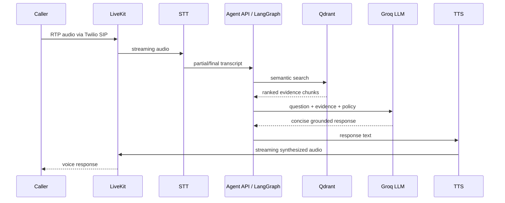
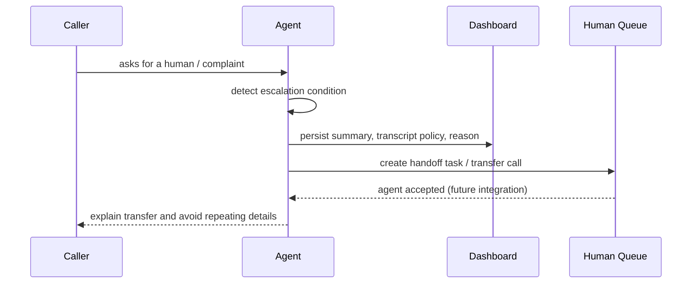

# System Design

## Design principles
1. **Separate media from reasoning:** LiveKit owns realtime audio; the agent API owns business decisions.
2. **Grounded answers:** policy and product claims require retrieved evidence or a verified tool result.
3. **Deterministic business actions:** the LLM may request a tool, but server-side code validates every argument and authorization.
4. **Fail safely:** low confidence, missing data, tool errors and caller frustration trigger clarification or human handoff.
5. **Tenant-ready:** every persisted object and vector payload must carry `tenant_id` before multi-company rollout.

## Sequence — FAQ call

## Sequence — human handoff

## LangGraph state
`session_id`, `message`, `intent`, `confidence`, `context`, `sources`, `tool_result`, `response`, `escalated`, `escalation_reason`.

The current graph is intentionally compact. A production graph should add nodes for language detection, PII redaction, customer authentication, sentiment/risk, clarification loops, tool authorization, post-call summarization, and durable checkpointing. Use a Postgres-backed checkpointer and a unique thread ID per call.

## Latency budget (initial target, measure in deployment)
| Stage | Target p95 |
|---|---:|
| End-of-turn detection | 250–500 ms |
| STT finalization | 200–500 ms |
| Retrieval | 50–150 ms |
| LLM first token | 300–900 ms |
| TTS first audio | 150–500 ms |
| **Target perceived response start** | **under 2 seconds** |

Streaming partials, short prompts, small top-k, regional placement and fast TTS are important. These are engineering targets, not measured guarantees.

## Scaling
- API: stateless replicas behind a load balancer.
- Voice workers: horizontally scale by concurrent sessions; use LiveKit dispatch and worker capacity limits.
- Qdrant: persistent volumes, snapshots, backups, payload indexes and tenant filters.
- Postgres: managed HA database, connection pool, migrations and PITR backups.
- Redis: rate limits, short-lived session cache and distributed locks.
- Queue: add a durable queue for post-call summaries, analytics and document ingestion.

## Data model (recommended production schema)
- `tenants(id, name, plan, created_at)`
- `users(id, tenant_id, email, role, password_hash, created_at)`
- `calls(id, tenant_id, provider_call_id, caller_hash, started_at, ended_at, status, outcome, consent_status)`
- `transcript_segments(id, call_id, speaker, text_redacted, timestamp_ms)`
- `tool_events(id, call_id, tool_name, request_hash, result_status, idempotency_key)`
- `knowledge_documents(id, tenant_id, title, checksum, status, created_at)`
- `appointments(id, tenant_id, customer_id, requested_at, status, idempotency_key)`
- `audit_events(id, tenant_id, actor, action, resource, created_at)`

Do not store raw payment credentials or authentication secrets. Prefer hashed caller identifiers and encrypted PII only when operationally required.
